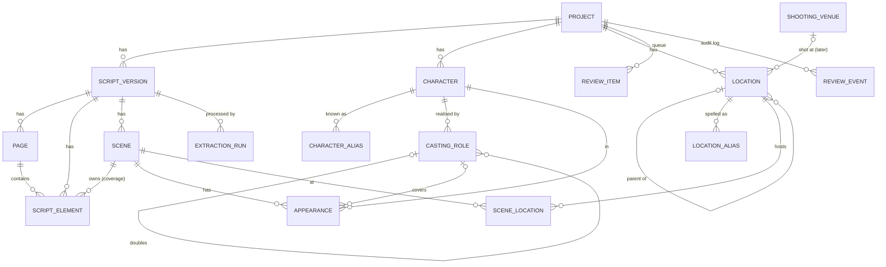

# Data model

The schema in `backend/app/models/` is the implementation of this document. If they
disagree, the code is wrong. Covered by `backend/tests/test_schema.py`.

## Design principles

1. **Two kinds of data, kept apart.**
   - *Source data* — what was imported: `script_versions → pages → script_elements`.
     It is never edited, only annotated.
   - *Extracted facts* — what we read out of the source: scenes, characters, aliases,
     casting roles, appearances, locations, scene↔location links. Every fact table
     uses the **ProvenanceMixin**.
2. **Story entities are not production entities.** A *Character* is someone in the story;
   a *CastingRole* is someone you hire. A *Location* is a place in the story; a
   *ShootingVenue* is where you film it.
3. **Uncertainty is stored, not resolved.** Unknown headcount = `NULL` + raw text + flag.
   Relative time = stored as written + a separate, flagged *inherited* value.
4. **Soft merges.** Merging two characters/locations sets `status=merged` and
   `merged_into_id`; nothing is deleted, so every merge can be inspected and undone.
5. **Reports read facts where `review_status != rejected`.** Unreviewed facts are counted
   but reports show how many of the contributing facts are still unreviewed.

## Entity diagram



## Provenance — on every extracted fact

| Column | Meaning |
|---|---|
| `source_scene_id` | Scene the fact was read from |
| `source_element_start_id` / `_end_id` | Exact range of script elements (lines) supporting it |
| `source_excerpt` | Verbatim quote of the supporting text |
| `extracted_by` | `parser` · `ocr` · `llm` · `reconciliation` · `human` |
| `extraction_run_id` | Which run (model + prompt version) produced it |
| `confidence` | 0.0–1.0 (DB-enforced range) |
| `needs_review` + `review_reason` | Flag + machine-readable reason(s), e.g. `continuous_time` |
| `review_status` | `unreviewed` · `confirmed` · `edited` · `rejected` |
| `reviewed_at` / `reviewed_by` | Who signed it off |

`QuantityMixin` (`quantity_min`, `quantity_max`, `quantity_raw`) is used wherever a count
appears. "FOUR GOONS" → 4/4. "a huge crowd" → NULL/NULL + raw text + `needs_review`.

## Source tables

**projects** — one production. Characters and locations belong to the project (not the
script version) so they survive revisions in Stage 3.

**script_versions** — one imported file: filename, format, SHA-256, page count, status
(`importing → imported → extracted → reconciled`), revision label/colour/date (Stage 3).

**pages** — every physical (PDF) or computed (DOCX/FDX/Fountain) page: `page_index`
(physical order), `page_label` (printed number, e.g. "23A"), `text_source`
(`text_layer`/`ocr`/`structured`), `raw_text`, `ocr_mean_confidence`, `is_title_page`.

**script_elements** — every typed block of text in order (`scene_heading`, `action`,
`character`, `parenthetical`, `dialogue`, `transition`, `shot`, `page_header`,
`title_page`, `unknown`), with page, owning scene, raw + normalised text, line count and
PDF y-coordinates (for 1/8-page lengths). **Coverage proof:** every element is either in
a scene, is non-scene furniture, or produces a review item.

**extraction_runs** — every automated pass (import, extraction, reconciliation) with
model, prompt version, params, stats, errors.

## Scenes

| Field | Rule |
|---|---|
| `seq` | Order in the script (1..N). Internal only. |
| `scene_number` | **Original number, verbatim** ("23", "23A", "A23"). `NULL` if the script has none — never generated. |
| `scene_number_right` | Right-margin number when it differs from the left |
| `number_status` | `ok` · `missing` · `mismatch` · `duplicate` · `out_of_order` |
| `is_omitted` | "23 OMITTED" placeholders are kept as scenes |
| `heading_raw`, `heading_status` | `ok` · `ambiguous` · `inferred` (no heading found; boundary guessed → always review) |
| `int_ext` + `int_ext_raw` | `INT` · `EXT` · `INT/EXT` · `UNKNOWN` |
| `location_raw` | Location text from the heading, verbatim |
| `time_of_day` + `time_of_day_raw` | **As written**: `DAY NIGHT DAWN DUSK SUNRISE SUNSET MORNING AFTERNOON EVENING CONTINUOUS SAME LATER MOMENTS LATER UNSPECIFIED OTHER` |
| `effective_time_of_day` | For relative times only: lighting inherited from the nearest earlier absolute-time scene; `effective_time_source_scene_id` says which one; `effective_time_needs_review` is always true until confirmed |
| `start/end_page_id`, `start/end_page_label` | Source page references |
| `length_eighths` + `length_method` | Integer eighths (13 = 1 5/8 pp). `pdf_geometry` (vertical extent on the real page) or `line_count` (computed pagination for DOCX/FDX/Fountain) |
| `synopsis` | Short description (LLM), with run id |

Provenance on a scene covers the **heading parse** (source = the heading element).

## Characters, casting, appearances

**characters** — a story entity: `canonical_name`, `kind` (`individual` / `group`),
description, soft-merge fields. Groups use `QuantityMixin` for headcount.

**character_aliases** — every name used for the character (cue names and names in
action), normalised. Linking an alias to a different character is a reconciliation
proposal in the review queue.

**casting_roles** — a hiring need for a character: `kind` = `actor` · `voice` ·
`stunt_double` · `photo_double` · `body_double`; `name` ("Young Arjun"), `age_note` as
written, `doubles_role_id` for doubles.
*"Young Arjun" and "Adult Arjun" = one Character, two `actor` CastingRoles.*

**appearances** — one row per (scene, character, casting role):

| `presence` | Meaning | Counts as an appearance? |
|---|---|---|
| `present` | Physically in the scene — **speaking or silent** | **Yes** |
| `off_screen` | (O.S.)/(O.C.): in the scene's space, unseen | **Yes** (shown separately — see decision 1) |
| `voice_only` | (V.O.), phone/radio voice; not physically there | No — voice casting need |
| `mentioned` | Only talked about | **Never** — stored so the AD sees it was considered |
| `uncertain` | Text doesn't say | Not until reviewed; always `needs_review` |

`speaking` = `speaking` · `silent` · `unknown`. `dialogue_block_count` is counted by the
**parser** from dialogue cues — not by the LLM. `name_as_written` keeps how this scene
refers to the character.

## Locations

**locations** — self-referencing tree of any depth: `parent_id`, `kind`
(`story_location` / `set`), soft-merge fields, and `venue_id` (empty until the locations
department fills it).

```
ARJUN'S HOUSE (story_location)
 ├─ KITCHEN (set)
 └─ BEDROOM (set)
CITY HOSPITAL (story_location)
 ├─ ICU (set)
 └─ CORRIDOR (set)
```

**location_aliases** — every heading spelling mapped to a location ("ARJUNS HOUSE -
KITCHEN", "KITCHEN - ARJUN'S HOUSE").

**scene_locations** — scene ↔ location with `role` = `primary` · `intercut` ·
`secondary`. A scene links to its most specific location (the set); reports can roll up
to the parent.

**shooting_venues** — real-world places. Exists now so Stage 3 needs no restructuring.

## Review queue and audit log

**review_items** — one queue for everything (`category` = `import` · `extraction` ·
`reconciliation`), with `reason_code`, `severity`, message, a polymorphic pointer to the
fact (`entity_table`, `entity_id`) so Stage 2 tables plug in unchanged, direct links to
the source (`scene_id`, `page_id`, `element_id`), and an optional machine-applicable
`proposal` (e.g. `{"action":"merge_character","from_id":12,"into_id":3}`).
Status `open → resolved/dismissed` with resolution and note.

**review_events** — append-only audit log: entity, action
(confirm/edit/reject/create/merge/unmerge), before/after JSON snapshots, actor, time.

### How a correction propagates
Reports are queries, not stored numbers. When the AD rejects an appearance, its
`review_status` becomes `rejected`, an event is logged, and every report that reads
appearances simply stops counting it on the next request. No cache to invalidate.

## Decisions I'd like you to confirm

1. **O.S. counts as an appearance** (actor needed on set), shown as a separate column so
   it can be excluded. V.O. does *not* count as an on-set appearance. OK?
2. **Relative times** (CONTINUOUS/SAME/LATER/MOMENTS LATER): reports group by the
   *as-written* value by default, with a toggle to group by the *inherited* value
   (marked as inferred). OK?
3. **Scenes link to the most specific location** (the set), with roll-up to parent in
   reports — rather than linking to both. OK?
4. **Group characters** with dialogue ("GOONS", "VILLAGERS") are characters with unknown
   headcount; non-speaking crowds wait for Stage 2 background. OK?
5. **Page lengths**: for PDFs, 1/8ths from real geometry; for DOCX/FDX/Fountain, from
   standard pagination (~55 lines/page), so they may differ slightly from Final Draft's
   own count. Acceptable?
